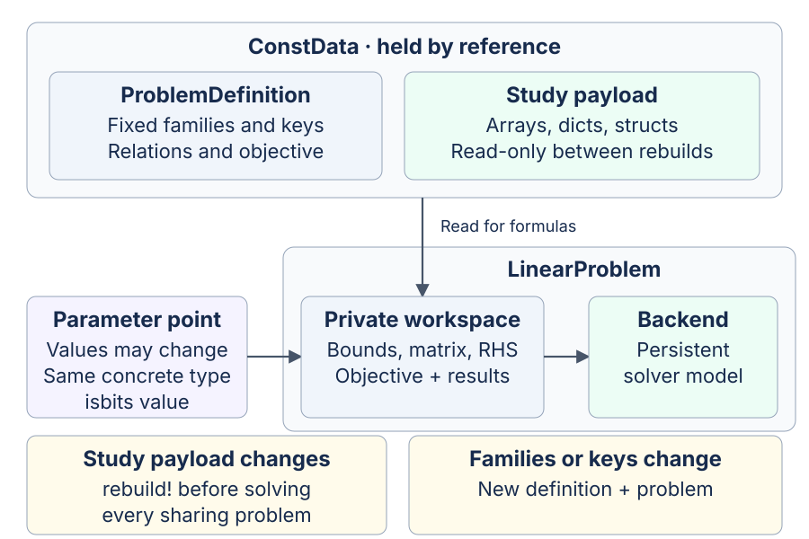

# ReactiveModel.jl

ReactiveModel solves a family of linear programs (LPs) at successive parameter points.
You define the equations and their dependence on study data and parameters.
The library retains a solver model and sends numerical updates as needed.

For example, a dispatch model can use the same generators and balance equation
at every time step while demand changes. The [first tutorial](tutorials/first-model.md)
builds and checks that example from start to finish.

The definition fixes the families and their keys. Study data stays read-only
between rebuilds; a parameter point selects the numerical state. Each problem
owns its workspace and solver model:

```@raw html
<div class="rm-diagram" tabindex="0" role="group" aria-label="Definition, inputs and owned numerical state">
```



```@raw html
</div>
```

Start with `safe_mode=true` while checking the formulation and its update
conditions. The [data guide](guide/concepts.md) explains these ownership rules;
the [solve-cycle guide](guide/solve-cycle.md) shows what a solve evaluates and
which results can be retained.

## Start here

1. [Install from a checkout](installation.md) and run the small example.
2. [Build your first model](tutorials/first-model.md) and check its numerical results.
3. Use [business functions and safe mode](tutorials/business-functions.md) in an application driver.
4. Read [data and dependencies](guide/concepts.md) before changing study arrays.
5. Read [results and errors](guide/solve-cycle.md) before retaining solutions or
   running concurrent solves.

The remaining tutorials cover [function-based construction](tutorials/first-model-functional.md),
[network flows with tuple keys](tutorials/indexed-families.md),
[a reservoir stage problem](tutorials/bellman-recursion.md), and
[a complete small SDDP training loop](tutorials/sddp.md).

## Scope

The main target is continuous linear programming with fixed variable and
constraint families. HiGHS also supports integer and binary domains. The
[DSL reference](guide/dsl.md) specifies the accepted language and the
[backend guide](backends.md) lists solver capabilities.

ReactiveModel is experimental. Parameters must be `isbits` values of one concrete
type per problem. Study data may be mutable, but must remain constant between
rebuilds. Changing family keys or dimensions requires a new definition.

JuMP, MathOptInterface and ParametricOptInterface offer related modeling and
parameter-update facilities. The [modeling approaches](why/ergonomics.md) page
explains the different contracts without assigning a general ranking.

## Reproduction and reference

The [serial/parallel protocol](parallel-results.md) describes direct Clp_jll and
HiGHS_jll paths alongside explicit JuMP implementations using ThreadTeams.
The [JuMP comparison page](benchmarks-jump.md) shows the formulations and update
loops, and the [input specification](benchmark-inputs.md) defines the synthetic
presets. The [performance guide](why/performance.md) explains what to measure;
the [benchmark method](benchmarks.md) gives consistency checks and reporting
requirements. Collect results for the source and environment you plan to use.

The [compilation guide](guide/trimming.md) describes the application validated
with JuliaC trimming and the versions and platform used. The
[API reference](api.md) lists constructors, callbacks and result queries.
The [design guide](guide/design.md) explains implementation choices and their
[compilation diagnostic protocol](compilation-results.md).
