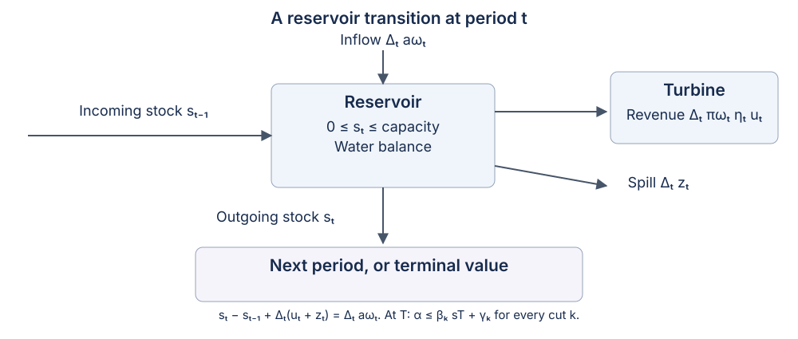

# A reservoir stage problem

A reservoir can release water now or retain it for later. This example maximizes
three-period generation revenue plus a supplied concave piecewise-linear
terminal value. It is a stage problem that can be used within a dynamic
programming algorithm; it does not implement a full Bellman or SDDP algorithm.

The parameter point selects an inflow/price scenario and an initial stock.
All inputs below are synthetic. Run the blocks in order after
[installation](../installation.md).



## Formulation and units

For period ``t``, ``s_t`` is stored volume, ``u_t`` turbine flow and ``z_t`` spill.
With period duration ``\Delta_t``, water balance is

```math
s_t-s_{t-1}+\Delta_t(u_t+z_t)=\Delta_t a_{\omega t}.
```

Capacity bounds limit stock and turbine flow; spill is nonnegative.
The initial stock is fixed to the parameter. The supplied terminal value is
represented by ``\alpha\le\beta_k s_T+\gamma_k`` for every cut ``k``. The
objective is ``\sum_t\Delta_t\pi_{\omega t}\eta_tu_t+\alpha``.

Use consistent units: here durations are hours, flow is volume/hour, and yield
converts volume to energy. Prices are currency/energy; the terminal coefficients
are chosen so that the terminal value is in currency.

## Study data and parameters

```@example bellman
using ReactiveModel

data = (
    T=3,
    capacity=100.0,
    turbine_max=[20.0, 20.0, 20.0],
    duration=[1.0, 1.0, 1.0],
    inflow=[5.0 2.0 1.0; 2.0 3.0 4.0],
    price=[50.0 40.0 60.0; 30.0 70.0 45.0],
    yield=[0.9, 0.9, 0.9],
    nCuts=2,
    beta=[4.0, 1.5],
    gamma=[0.0, 100.0],
)
struct BellmanParameters
    scenario::Int
    initial_stock::Float64
end
nothing # hide
```

The parameter struct is `isbits`; the arrays remain in study data.

## Define and check one point

```@example bellman
@model ReservoirTransition(data, point) begin
    T = 1:data.T
    Cuts = 1:data.nCuts
    @variable initial_stock in [point.initial_stock, point.initial_stock]
    @variable stock[t in T] in [0.0, data.capacity]
    @variable turbine[t in T] in [0.0, data.turbine_max[t]]
    @variable spill[t in T] in [0.0, Inf]
    @variable alpha in [-Inf, Inf]
    @constraint water_balance[t in T] begin
        stock[t] - (t == 1 ? initial_stock : stock[t - 1]) +
        data.duration[t] * (turbine[t] + spill[t]) ==
        data.duration[t] * data.inflow[point.scenario, t]
    end
    @constraint terminal_cut[k in Cuts] alpha - data.beta[k] * stock[data.T] <= data.gamma[k]
    @objective Max sum(data.duration[t] * data.price[point.scenario, t] * data.yield[t] * turbine[t] for t in T) + alpha
end

point = BellmanParameters(1, 60.0)
shared = ConstData(ReservoirTransition(data), data)
problem = LinearProblem(shared, point; backend=HiGHSBackend())
solution = solve(problem, point)
@assert isapprox(objective_value(solution), 2732.0)
@assert isapprox(primal(solution, :stock, 3), 8.0; atol=1e-8)
objective_value(solution)
```

At this point, all three turbines release 20 units/hour. Revenue is 2700,
ending stock is 8, and the terminal value is ``\min(4\times8,1.5\times8+100)=32``.
Dependency inference separates the initial-stock bound from scenario-dependent
inflows and objective coefficients. The terminal cuts remain invariant.

## Tabulate scenarios and initial states

```@example bellman
stock_grid = 0.0:20.0:100.0
scenarios = 1:2
values = zeros(length(scenarios), length(stock_grid))
for (i, scenario) in enumerate(scenarios), (j, stock) in enumerate(stock_grid)
    p = BellmanParameters(scenario, stock)
    values[i, j] = objective_value(problem, p)
    fresh = LinearProblem(shared, p)
    @assert isapprox(values[i, j], objective_value(fresh, p); atol=1e-8)
end
@assert all(isfinite, values)
values
```

The table stores numerical values, rather than references to a reused live
solution. The fresh-problem comparison checks incremental consistency for this
small grid; it is not a mathematical certificate for arbitrary inputs.

## Inspect a sensitivity

```@example bellman
solution = solve(problem, point)
water_dual = dual(solution, :water_balance, 1)
base_value = objective_value(solution)
step = 1e-4
nearby_value = objective_value(problem, BellmanParameters(1, 60.0 + step))
slope = (nearby_value - base_value) / step
@assert isapprox(slope, 4.0; atol=1e-5)
(water_dual, slope)
```

The local value slope here is 4 currency units per volume unit. Row duals
refer to the normalized equations; interpret them with the equation sign and
objective sense. At breakpoints or degenerate points, duals can be nonunique.
Deriving cuts for another stage requires the algorithm's own assumptions and
sign conventions, rather than using a row dual without that derivation.

## Concurrent evaluations

ThreadTeams dispatches one chunk per scenario below. Each chunk owns a separate
problem and writes a separate result row; study data are shared read-only.
Workspaces are indexed by chunk, not `threadid()`, so chunk rescue or placement
changes do not select another chunk's solver state. The initial construction is
outside the parallel loop.

```@example bellman
import ThreadTeams

function parallel_table(shared, scenarios, stock_grid)
    problems = [LinearProblem(shared, BellmanParameters(scenario, 0.0);
                              backend=HiGHSBackend()) for scenario in scenarios]
    results = zeros(length(scenarios), length(stock_grid))
    ThreadTeams.foreach_chunk(length(scenarios)) do i
        scenario = scenarios[i]
        problem = problems[i]
        for (j, stock) in enumerate(stock_grid)
            results[i, j] = objective_value(problem, BellmanParameters(scenario, stock))
        end
    end
    results
end
parallel_values = parallel_table(shared, scenarios, stock_grid)
@assert parallel_values ≈ values
parallel_values
```

ThreadTeams is a documentation/benchmark dependency, not a ReactiveModel runtime
dependency. To run this optional section from a checkout, instantiate `--project=docs`
and start Julia with `julia -t 2 --project=docs`. The same code checks the result
with one Julia thread. This example demonstrates workspace ownership, not a
measured speedup. The [benchmark campaign](../parallel-results.md) records the
ThreadTeams version, spin policy, chunk count and measured dispatch allocations.
Avoid oversubscribing solver threads when choosing an application worker count.

If cut coefficients change, stop concurrent work and rebuild every affected
problem. Adding cuts changes family keys and requires new definitions. See
[data and dependencies](../guide/concepts.md) and the
[performance guide](../why/performance.md).

## Continue to SDDP

This stage example uses terminal cuts supplied as data. The
[SDDP tutorial](sddp.md) constructs those future-cost approximations with
forward/backward passes and dual-based cuts, and compares the resulting policy
with a complete scenario-tree optimum.
