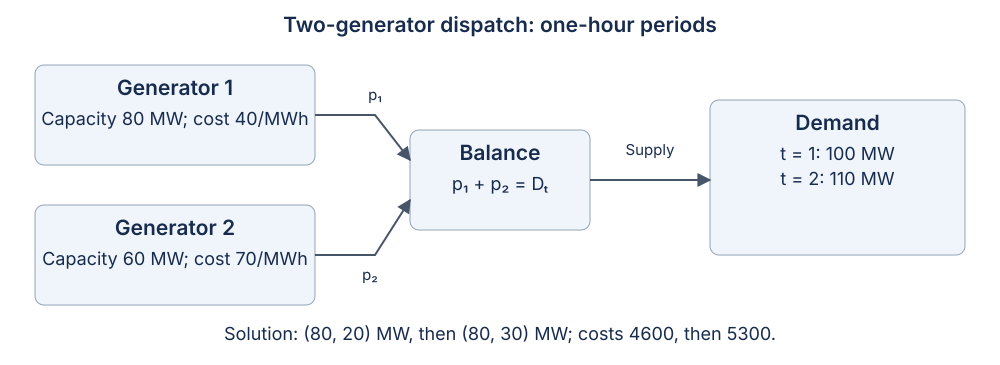

# Build a model with functions

This tutorial builds the same two-generator problem as [the DSL tutorial](first-model.md).
Use function-based construction when application code needs to generate families
or supply numerical callbacks directly. Run the blocks in order after
[installation](../installation.md).



## Data and bounds

A bound callback receives `(data, point, key)`; a constant number can also be
used as a bound. Here, the generator key is an integer.

```@example dispatch_functional
import ReactiveModel as RM

data = (capacity=[80.0, 60.0], cost=[40.0, 70.0], demand=[100.0, 110.0])
production = RM.VariableBlock(:production, 1:2;
    lower=0.0,
    upper=(d, p, g) -> d.capacity[g],
    has_changed=(previous, current) -> false,
)
nothing # hide
```

The explicit predicate is valid because capacity stays constant between rebuilds.
Without it, the functional constructor defaults to reevaluation at distinct
points. Unlike the DSL, the functional API does not inspect callback syntax to
infer dependencies.

## Balance and objective

The constraint callback emits variable coefficients. The RHS callback returns
a scalar. The singleton key `(nothing,)` creates one balance row.

```@example dispatch_functional
balance = RM.ConstraintBlock(:balance, (nothing,), :eq,
    (emit, d, p, key) -> begin
        for g in 1:2
            RM.set_coeff!(emit, :production, g, 1.0)
        end
    end,
    (d, p, key) -> d.demand[p.t],
)

cost = RM.Objective(:min,
    (emit, d, p) -> begin
        for g in 1:2
            RM.set_coeff!(emit, :production, g, d.cost[g])
        end
    end;
    has_changed=(previous, current) -> false,
)
nothing # hide
```

`set_coeff!(emit, :production, g, value)` identifies a variable by family name
and key. Callbacks must emit the complete current expression whenever evaluated,
not just differences from an earlier call. Keep callbacks pure with respect to
their explicit inputs. A predicate returning `false` must imply that all values
it guards are unchanged.

## Assemble and verify

The named-tuple keys must agree with the block names.

```@example dispatch_functional
definition = RM.ProblemDefinition(
    variables=(production=production,),
    constraints=(balance=balance,),
    objective=cost,
)
problem = RM.LinearProblem(RM.ConstData(definition, data), (t=1,);
                           backend=RM.HiGHSBackend(), safe_mode=true)
first_cost = RM.objective_value(problem, (t=1,))
solution = RM.solve(problem, (t=2,))
values = [RM.primal(solution, :production, g) for g in 1:2]
@assert isapprox(first_cost, 4600.0)
@assert isapprox(RM.objective_value(solution), 5300.0)
@assert values ≈ [80.0, 30.0]
(first_cost, RM.objective_value(solution), values)
```

The data contract and result lifetime are identical to those of a DSL model.
Safe mode reevaluates all callbacks independently of their predicates; inspect
`RM.update_report(problem)` before refining those conditions. See the
[business-function tutorial](business-functions.md) for that workflow.
See [data and dependencies](../guide/concepts.md),
[results and errors](../guide/solve-cycle.md), and the
[callback reference](../api.md) for custom family types and extension methods.
