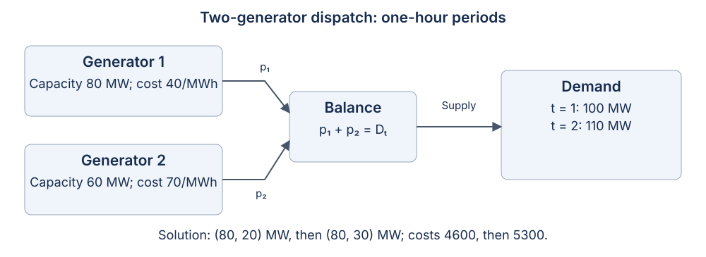

# Your first model

This tutorial solves a dispatch problem for two one-hour periods. Two generators
supply a demand at minimum cost. The capacities are 80 and 60 MW; marginal costs
are 40 and 70 currency units/MWh. Demand is 100 MW, then 110 MW.

For each period, the model is:

```math
\begin{aligned}
\min_p\quad &40p_1 + 70p_2 \\
\text{subject to}\quad &p_1+p_2=D_t,\\
&0\le p_1\le80,\quad 0\le p_2\le60.
\end{aligned}
```



First complete [installation](../installation.md). Run the blocks below in
order in one Julia session. Documenter executes these blocks when building the
manual; the complete script is `examples/getting_started.jl`.

## Define the family

The `@model` macro provides an algebraic modeling syntax (DSL). A variable family
contains variables indexed by keys; here the generator keys are 1 and 2.
The balance has a right-hand side (RHS) selected by `t`.

```@example dispatch
using ReactiveModel

@model Dispatch(data, point) begin
    @variable production[g in 1:2] in [0.0, data.capacity[g]]
    @constraint balance sum(production[g] for g in 1:2) == data.demand[point.t]
    @objective Min sum(data.cost[g] * production[g] for g in 1:2)
end

data = (capacity=[80.0, 60.0], cost=[40.0, 70.0], demand=[100.0, 110.0])
problem = LinearProblem(ConstData(Dispatch(data), data), (t=1,);
                        backend=HiGHSBackend(), safe_mode=true)
nothing # hide
```

`Dispatch(data)` creates the mathematical definition. `ConstData` associates it
with the study arrays. `LinearProblem` owns the numerical workspace and solver.
The point `(t=1,)` selects the first demand. The numerical model is assembled
on the first solve.

The DSL infers that the balance RHS depends on `t`, while bounds, matrix
coefficients and costs do not. No explicit update condition is needed here.
We start in safe mode: all formulas are reevaluated and compared on every solve,
so an incomplete condition could not suppress an update. `update_report(problem)`
collects observations after the first numerical construction.

## Solve and check

```@example dispatch
solution = solve(problem, (t=1,))
first_cost = objective_value(solution)
first_production = [primal(solution, :production, g) for g in 1:2]
@assert is_optimal(solution)
@assert isapprox(first_cost, 4600.0)
@assert first_production ≈ [80.0, 20.0]
(first_cost, first_production)
```

The less expensive generator supplies 80 MW. The second supplies the remaining
20 MW. The cost is ``40\times80+70\times20=4600``.

```@example dispatch
second_solution = solve(problem, (t=2,))
second_cost = objective_value(second_solution)
second_production = [primal(second_solution, :production, g) for g in 1:2]
@assert isapprox(second_cost, 5300.0)
@assert second_production ≈ [80.0, 30.0]
(second_cost, second_production)
```

The solver model is retained and the RHS changes from 100 to 110.
Reoptimization work depends on the solver and numerical problem.

## Retain values explicitly

Both solution variables refer to the same reusable live object:

```@example dispatch
@assert solution === second_solution
@assert isapprox(objective_value(solution), 5300.0)
@assert first_production ≈ [80.0, 20.0]
(first_cost, objective_value(solution))
```

`first_cost` and `first_production` retain earlier values because they were
copied into a scalar and a new vector. Store values this way when building a
time series. Reading `solution.variables.production` materializes a snapshot
collection; scalar `primal` queries do not materialize that collection.

## Query a dual or only the objective

```@example dispatch
balance_dual = dual(second_solution, :balance)
@assert isapprox(balance_dual, 70.0)
value_at_first_point = objective_value(problem, (t=1,))
@assert isapprox(value_at_first_point, 4600.0)
(balance_dual, value_at_first_point)
```

For this continuous minimization problem, the balance dual is the local marginal
cost of increasing demand. Its interpretation depends on the equation's sign
and normalization. It is not a dual for an integer solve.

`objective_value(problem, point)` solves without requesting result collections.
An unchanged numerical problem reuses its solved outcome. In safe mode formulas
are still reevaluated, including at an identical point. With `safe_mode=false`,
an identical point instead takes the whole-point cache path. These paths must
be distinguished when measuring performance.

## Continue

Keep `data` unchanged between rebuilds. After changing an array, call `rebuild!`
before the next solve, even at a new point. See [data and dependencies](../guide/concepts.md).
For result invalidation and errors, see [results and the solve cycle](../guide/solve-cycle.md).
For functions of study data and a complete point, a branching driver and safe-mode
reports, continue with [business functions](business-functions.md).

The [functional tutorial](first-model-functional.md) builds the same problem
with callbacks. The [network tutorial](indexed-families.md) introduces tuple keys.
