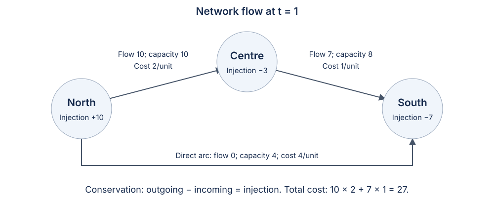

# Indexed families and network flow

This example sends flow through a directed network at minimum cost. A positive
node injection supplies flow; a negative one consumes it. For each node,
outgoing flow minus incoming flow equals its injection:

```math
\min_x\ \sum_{a\in A}c_{ta}x_a,\qquad
\sum_{a\in\delta^+(n)}x_a-\sum_{a\in\delta^-(n)}x_a=q_{tn},\qquad
0\le x_a\le\bar x_{ta}.
```

Run the blocks in order after [installation](../installation.md).
The inputs are synthetic and contained entirely in this page.



The drawing shows the first period. The code below checks both periods.

## Data and tuple keys

Arcs use tuple keys such as `(:north, :south)`. Node keys are symbols.
The dictionaries map those keys to columns in the time-series arrays.

```@example network
using ReactiveModel

arcs = [(:north, :centre), (:centre, :south), (:north, :south)]
nodes = [:north, :centre, :south]
data = (
    arcs=arcs,
    nodes=nodes,
    arc_pos=Dict(a => i for (i, a) in enumerate(arcs)),
    node_pos=Dict(n => i for (i, n) in enumerate(nodes)),
    capacity=[10.0 8.0 4.0; 9.0 7.0 5.0],
    cost=[2.0 1.0 4.0; 3.0 1.5 4.0],
    injection=[10.0 -3.0 -7.0; 8.0 -2.0 -6.0],
)
@assert all(iszero, vec(sum(data.injection; dims=2)))
nothing # hide
```

## Formulation

```@example network
@model NetworkFlow(data, point) begin
    @variable flow[a in data.arcs] in [0.0, data.capacity[point.t, data.arc_pos[a]]]
    @constraint conservation[n in data.nodes] begin
        sum(flow[a] for a in data.arcs if a[1] == n) -
        sum(flow[a] for a in data.arcs if a[2] == n) ==
        data.injection[point.t, data.node_pos[n]]
    end
    @objective Min sum(data.cost[point.t, data.arc_pos[a]] * flow[a] for a in data.arcs)
end
problem = LinearProblem(ConstData(NetworkFlow(data), data), (t=1,))
nothing # hide
```

Dependencies are inferred: bounds, RHS values and costs depend on `t`; the
matrix coefficients depend only on the fixed network. This avoids reevaluating
the matrix formulas. It does not guarantee that the solver never refactorizes.

## Check costs, bounds and conservation

For these inputs, the expected costs are 27 and 30.5. Verify both periods and
compare the updated problem with a newly constructed one:

```@example network
costs = Float64[]
for t in 1:2
    solution = solve(problem, (t=t,))
    flows = [primal(solution, :flow, a) for a in arcs]
    @assert all(flows .>= -1e-8)
    @assert all(flows .<= data.capacity[t, :] .+ 1e-8)
    for n in nodes
        net = sum((flows[i] for (i, a) in enumerate(arcs) if a[1] == n); init=0.0) -
              sum((flows[i] for (i, a) in enumerate(arcs) if a[2] == n); init=0.0)
        @assert isapprox(net, data.injection[t, data.node_pos[n]]; atol=1e-8)
    end
    fresh = LinearProblem(ConstData(NetworkFlow(data), data), (t=t,))
    value = objective_value(solution)
    @assert isapprox(value, objective_value(fresh, (t=t,)))
    push!(costs, value)
end
@assert costs ≈ [27.0, 30.5]
costs
```

The filtered sums also cover nodes with no incoming or outgoing arcs.
For larger networks, precomputed adjacency lists can reduce repeated scans of
the arc collection; choose the formulation according to the application size.

## Read keyed results

```@example network
solution = solve(problem, (t=2,))
(primal(solution, :flow, (:north, :south)),
 dual(solution, :conservation, :south))
```

These scalar queries do not materialize full result collections. Conservation
rows are linearly dependent, so node duals need not be unique. Relative prices
and sensitivity interpretations require a consistent sign and reference choice.

Keys in a family must have one concrete type, stable equality and hashing, and
no duplicates. Family ranges and filters cannot depend on the parameter point.
Changing network keys requires a new definition and problem. See the
[grammar](../guide/dsl.md) for multidimensional families and empty index spaces.
