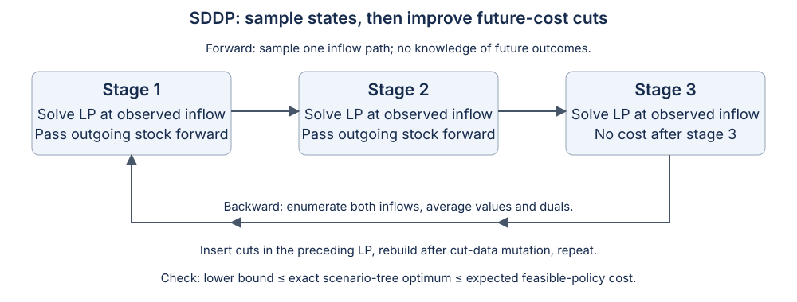

# A small SDDP training loop

Stochastic dual dynamic programming (SDDP) approximates future cost using linear
cuts. A forward pass samples states reached by a policy. A backward pass uses
LP values and duals at those states to improve the approximations.

This tutorial implements a small risk-neutral, three-stage example using
ReactiveModel for the stage LPs. The complete runnable file is `examples/sddp.jl`.
It includes an independent scenario-tree formulation for checking the result.
For the general algorithm and an established implementation, see the
[SDDP.jl introduction](https://sddp.dev/stable/tutorial/first_steps/) and
[introductory theory](https://sddp.dev/stable/explanation/theory_intro/).
This example does not use SDDP.jl or provide an RM optimizer for SDDP.jl.



## The decision problem

One reservoir begins with 4 units of water and holds at most 6. Each period has
energy demand 4. One unit of turbine release produces one unit of energy;
thermal generation covers the remainder. Thermal unit costs are 1, 2 and 4
in stages 1, 2 and 3. Spill is allowed and costs nothing.

The first-stage inflow is zero. At stages 2 and 3, inflows are independent:
zero or two units, each with probability one half. The current inflow is observed
before the decision; future inflows are unknown. Stage-one decisions are common
to all future histories. This information order is essential: solving each full
path with advance knowledge would solve a different problem.

For incoming stock ``x`` and observed inflow ``\xi``, the stage problem is

```math
\begin{aligned}
Q_t(x,\xi)=\min\quad &c_t g+\theta\\
\text{subject to}\quad &s+h+z=x+\xi,\\
&h+g=4,\\
&0\le s\le6,\quad 0\le h,g\le4,\quad z\ge0,\\
&\theta\ge0,\quad \theta\ge a_k+b_k s\quad\text{for every stored cut }k.
\end{aligned}
```

Here ``s`` is outgoing stock, ``h`` hydro generation, ``g`` thermal generation
and ``z`` spill. At the final stage, ``\theta=0``. Otherwise it approximates
expected cost in the next stage. Nonnegative costs justify the initial lower
bound zero. Thermal generation and spill give feasible recourse at every stock
in the stated domain. All stage problems are continuous LPs.

## Run the complete example

Complete [installation](../installation.md), then run from the repository root:

```sh
julia --startup-file=no --project=. examples/sddp.jl
```

Only ReactiveModel and Julia standard libraries are needed. The manual executes
the same file and verifies its numerical assertions:

```@example sddp
using ReactiveModel
include(joinpath(pkgdir(ReactiveModel), "examples", "sddp.jl"))
result = ReactiveModelSDDPExample.run_example(; verbose=true)
@assert isapprox(result.exact, 10.0; atol=1e-8)
@assert isapprox(result.lower, result.upper; atol=1e-8)
nothing # hide
```

With the recorded Julia version and default seed `20261112`, the lower bound
is 4 after the first pass, then 10; exact expected policy cost is 10. The checked
stopping condition is the numerical bound gap, not an assumed iteration count.

One optimal policy uses four units of thermal generation in stage 1 to preserve
water, costing 4. In stage 2, it keeps outgoing stock at 4 and releases only that
stage's inflow: thermal cost is 8 in the dry outcome or 4 in the wet outcome,
with expectation 6. Stage 3 can then meet all demand with water. Total expected
cost is therefore `4 + 6 + 0 = 10`. This illustrates why minimizing immediate
thermal cost at each stage would miss the value of stored water.

## The stage model

The following excerpt is read directly from the runnable file during the build.
It shows where RM's contract enters: a point holds incoming stock and inflow;
study arrays hold cut coefficients.

```@eval
using Markdown, ReactiveModel
source = read(joinpath(pkgdir(ReactiveModel), "examples", "sddp.jl"), String)
model = split(split(source, "@model HydroStage"; limit=2)[2], "\n# A separate formulation"; limit=2)[1]
Markdown.parse("```julia\n@model HydroStage" * model * "\n```")
```

The cut pool is allocated in advance with one row per allowed training iteration.
Unused rows initially impose `theta >= 0`, which is a valid lower bound here.
The number of rows stays fixed. Evaluating a new state/noise point changes the
balance RHS. Training changes cut slopes and intercepts in study data, so it
requires `rebuild!` before the affected problem is solved again.

This rebuild is a real part of training cost. Preallocation preserves keys but
does not make cut changes free or avoid the rebuild contract.

## Build a cut from duals

At a visited incoming stock ``\bar x``, solve stage ``t`` for both inflows. If
``\lambda_\xi`` is the balance-row dual, the expected supporting cut has

```math
\bar q=\sum_\xi p_\xi Q_t(\bar x,\xi),\qquad
\bar\lambda=\sum_\xi p_\xi\lambda_\xi,\qquad
V_t(x)\ge\bar q+\bar\lambda(x-\bar x).
```

Incoming stock appears with coefficient +1 on the RHS, so its minimization
value derivative has the balance dual's sign. For instance, in the final stage
at stock 1 and inflow 0, another water unit replaces thermal generation costing
4: the slope is −4. The script verifies this against a centered finite difference.

The backward pass visits stages 3, then 2. It stores each cut in the preceding
stage's future-cost approximation. The source excerpt below includes the required
rebuild after the study-array mutation:

```@eval
using Markdown, ReactiveModel
source = read(joinpath(pkgdir(ReactiveModel), "examples", "sddp.jl"), String)
backward = split(split(source, "function backward_pass!"; limit=2)[2], "\n# Exact expectation"; limit=2)[1]
Markdown.parse("```julia\nfunction backward_pass!" * backward * "\n```")
```

The forward pass samples one inflow history using a seeded `Xoshiro` generator.
The backward pass enumerates the complete two-point support at each visited
state; it does not replace the expectation by that forward sample. Under the
stated convex, risk-neutral, stagewise-independent model, these cuts are lower
approximations of the true expected value functions.

## Check the result without a statistical shortcut

There are only four complete random histories, so the example can enumerate
the current policy's expected immediate costs exactly. It excludes the approximate
`theta` term from realized cost. A feasible policy gives an upper bound; the
root LP using lower cuts gives a lower bound.

A separate scenario-tree LP has seven history nodes: one at stage 1, two at
stage 2, and four at stage 3. It assigns one decision to each observed prefix,
so histories sharing a prefix share that decision. Its optimum is 10.
At each training iteration, the script checks

```math
\text{lower bound}\le\text{scenario-tree optimum}\le\text{expected policy cost}.
```

It also checks nondecreasing lower bounds, a final gap below tolerance, and that
the learned cuts lie below independently solved future values on a stock grid.
The scenario tree uses the same LP solver with a different formulation, so these
are consistency checks rather than an independent solver certificate.

```@example sddp
[(iteration=row.iteration, lower=row.lower, policy_cost=row.upper)
 for row in result.history]
```

In a large SDDP application, exact policy expectation usually cannot be enumerated.
A sample mean from simulation is not a deterministic upper bound: use a suitable
statistical evaluation and stopping rule. The tiny tree here deliberately avoids
that uncertainty so the tutorial's answer can be checked.

## Does this establish an SDDP performance advantage?

It demonstrates the mechanics and their RM integration: repeated RHS updates,
dual queries, cut storage and rebuilds. It does not measure a production SDDP
implementation or establish an advantage over SDDP.jl. That comparison would
need matched training logic, sampling, cut management, stopping rules and
end-to-end costs.

The [measured LP benchmarks](../parallel-results.md) quantify repeated solves
with cuts held fixed. For training, measure cut insertion/rebuilds separately
from state/noise evaluations, then include both in total time. This teaching
implementation has no cut selection, risk measures, integer states or parallel
training. Those are additional algorithmic requirements, not frontend timing details.
